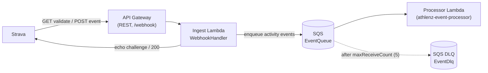
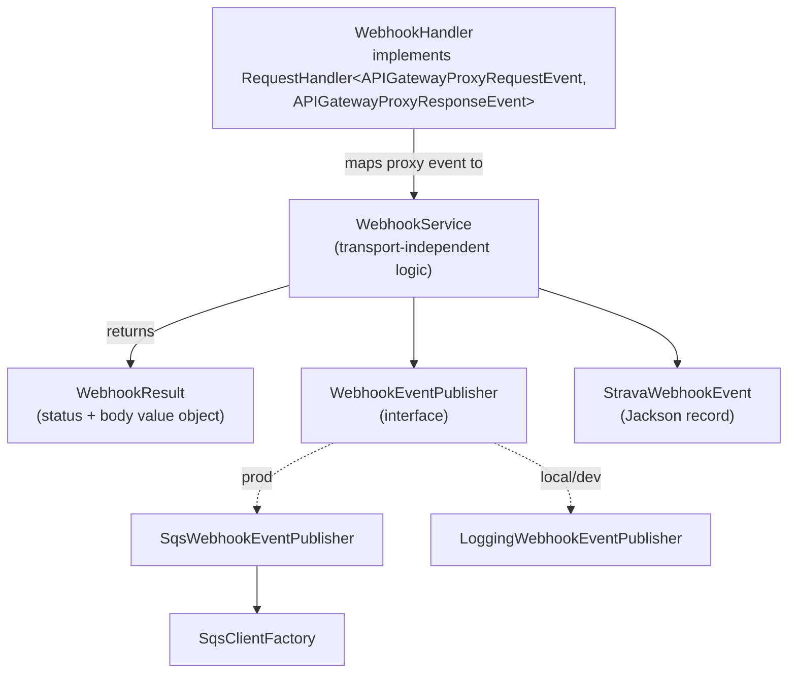
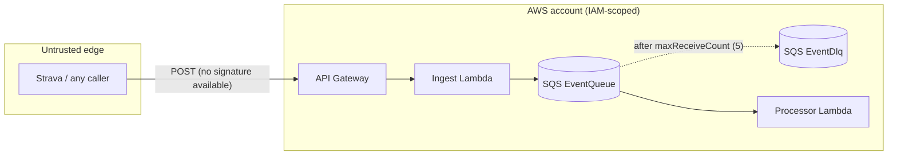
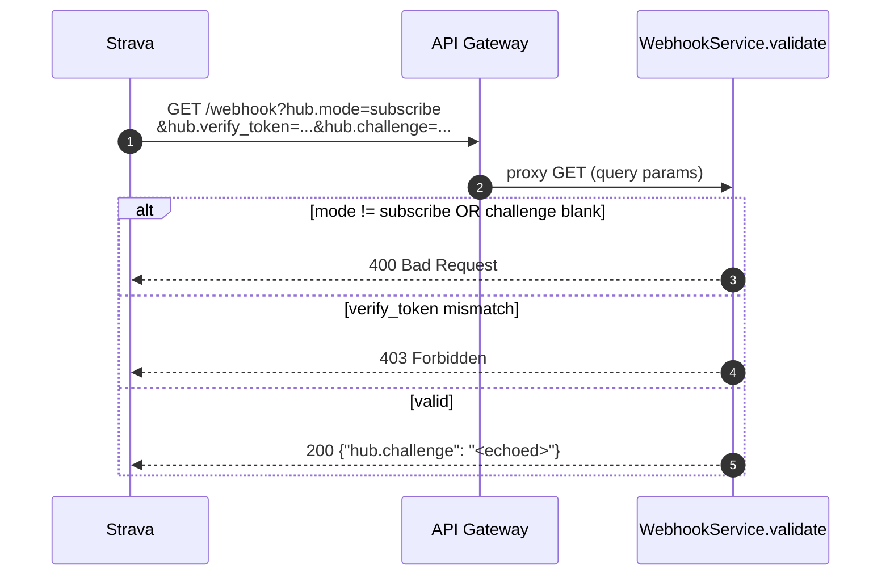
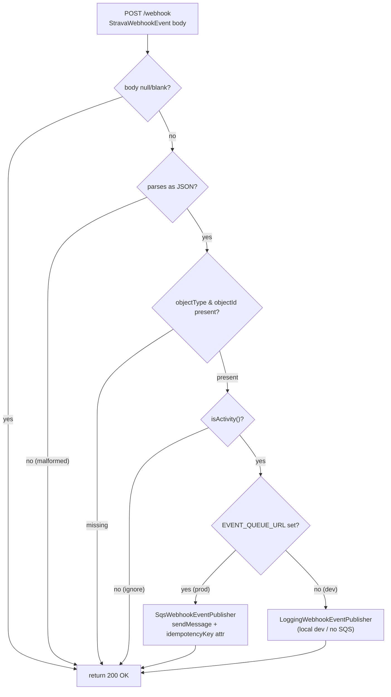

# athlenz-event-ingestor

## Overview

A standalone Strava **webhook ingest** function. Plain **Java 21** on the AWS
Lambda `java21` runtime, built with **Maven**, deployed with the **AWS SAM
CLI**. No application framework — the handler implements the AWS Lambda
`RequestHandler` directly against the API Gateway proxy event types. Only
helper libraries are used (Jackson for JSON, AWS SDK v2 for SQS, SLF4J Simple
for logging).

This is the **ingest half** of a two-function Strava webhook pipeline. It
acknowledges Strava fast and does no heavy work; a separate **processor**
function ([`athlenz-event-processor`](../athlenz-event-processor)) consumes the
SQS queue and does the slow work (OAuth, Strava API calls, DynamoDB
persistence) out of band.

Strava uses a single callback URL for two interactions:

- **GET** — the one-time subscription **validation handshake**. Strava sends
  `hub.mode=subscribe`, a `hub.verify_token` the function checks against
  `STRAVA_VERIFY_TOKEN`, and a `hub.challenge` the function echoes back as
  `{"hub.challenge":"..."}`. A wrong token returns **403**; a missing/invalid
  mode or challenge returns **400**.
- **POST** — ongoing **event deliveries**. The function validates the shape,
  enqueues valid `activity` events to **SQS**, and returns **200** immediately.
  Non-activity events and malformed bodies are acknowledged with 200 (no
  enqueue) to avoid Strava retry storms.

Downstream processing is out of scope for this app; events land on the SQS
queue for the separate processor to consume.

---

## Architecture

### System context

The ingest function sits at the untrusted edge, fronted by API Gateway, and
hands validated events to SQS. Everything heavy happens downstream.



Why a queue sits between ingest and the processor:

- **Different latency profiles** — ingest must answer Strava within ~2 seconds;
  the processor can take its time behind the queue.
- **Different dependencies** — ingest needs only SQS; the processor needs
  DynamoDB, Secrets Manager, and an HTTP client for the Strava API.
- **Durability** — if the processor is down or slow, events wait on the queue
  and are redriven to a DLQ after repeated failures rather than being lost.

### No framework — plain Lambda handler

Unlike a framework-based build (no Micronaut/Spring, no DI container, no
annotation processing), this app wires itself up in plain Java. Expensive
setup happens once in the handler constructor during the Lambda **init phase**
and is reused across warm invocations.



- `WebhookHandler` — the Lambda entrypoint. Does only the thin mapping from the
  API Gateway proxy request to a `WebhookService` call, and back to a proxy
  response. A no-arg constructor (used by Lambda) reads `System.getenv()`; a
  package-private constructor takes an explicit env map for tests.
- `WebhookService` — all the webhook logic, free of any Lambda / API Gateway
  types so it is unit-testable in isolation.
- `WebhookResult` — a small `record` (statusCode + body) the handler maps onto
  the proxy response. Factory methods: `ok()`, `ok(body)`, `badRequest()` (400),
  `forbidden()` (403), `methodNotAllowed()` (405).
- `WebhookEventPublisher` — a one-method publish abstraction with two
  implementations, selected at construction time (see below).
- `SqsClientFactory` — builds the AWS SDK v2 `SqsClient` once, using the lean
  `UrlConnectionHttpClient` for a smaller footprint and faster cold start.
- `StravaWebhookEvent` — the thin payload Strava POSTs, a plain Jackson `record`
  (`@JsonIgnoreProperties(ignoreUnknown = true)` + `@JsonProperty`). This app is
  fully self-contained — it carries its own copy of this type rather than
  sharing a common library.

### Trust boundaries and failure handling



- **The GET handshake is verified** (verify token); **event POSTs are not
  authenticated** — Strava sends no signature or per-event secret, so a caller
  cannot be cryptographically verified at the application layer.
- The real security boundary is **downstream**: the processor can only fetch
  real data for athletes whose OAuth tokens are stored. A forged event for an
  unknown athlete fails the token lookup downstream and is redriven to the DLQ —
  it cannot fabricate activity data.
- **Dead-letter queue** — after 5 failed receives a message moves to the
  `EventDlq` (14-day retention) for inspection.
- Edge hardening (API Gateway throttling, WAF rate limiting, a secret path
  segment in the callback URL) is the practical mitigation for forged-POST
  floods.

### Local vs deployed

The only difference between local and deployed behavior is one environment
variable. `SqsClientFactory` branches on `AWS_ENDPOINT_OVERRIDE` with no code
change at call sites:

- **Local** — set `AWS_ENDPOINT_OVERRIDE=http://localhost:4566` (e.g. a
  LocalStack/Floci emulator) and the client is pointed there with dummy static
  credentials and a fixed region. If `EVENT_QUEUE_URL` is unset, events are only
  logged.
- **Deployed** — leave `AWS_ENDPOINT_OVERRIDE` unset; the client uses the real
  AWS endpoints, the Lambda-provided region, and the function's IAM role
  credentials via the default chains.

---

## How it works

### Subscription validation handshake (GET)

Before Strava delivers any events it validates the callback once. This is the
only place the shared secret (the verify token) is checked.



The verify token (`STRAVA_VERIFY_TOKEN`) proves to Strava that the callback is
controlled by whoever created the subscription. It guards only this handshake —
see the trust-boundary note above. Token values are never logged.

### Event ingestion (POST) — fast ack and enqueue



The function intentionally returns **200 even for events it ignores** (empty,
malformed, non-activity) so Strava does not retry deliveries we do not want. A
4xx here would be retried.

**Publisher selection is a plain runtime choice**, decided once in the handler
constructor — no bean conditions or DI:

- When `EVENT_QUEUE_URL` is set and non-blank, the handler builds an
  `SqsClient` and uses `SqsWebhookEventPublisher`.
- Otherwise it falls back to `LoggingWebhookEventPublisher`, which logs instead
  of enqueuing (local dev / tests).

Each enqueued message carries an `idempotencyKey` message attribute
(`objectType#objectId#aspectType#eventTime`) so the downstream processor can
dedupe without re-parsing the body. A replay of the same event maps to the same
key.

---

## Project layout

```
athlenz-event-ingestor/
├── pom.xml                       # Maven build; shade plugin -> fat jar
├── template.yaml                 # SAM: Lambda + API Gateway + SQS (+ DLQ)
├── samconfig.toml.example        # copy to samconfig.toml, fill in secrets
└── src/
    ├── main/java/io/cb/strava/ingest/
    │   ├── WebhookHandler.java               # Lambda entrypoint (proxy mapping)
    │   ├── WebhookService.java               # transport-independent logic
    │   ├── WebhookResult.java                # status + body value object
    │   ├── WebhookEventPublisher.java        # publish abstraction
    │   ├── SqsWebhookEventPublisher.java     # SQS implementation
    │   ├── LoggingWebhookEventPublisher.java # local/dev fallback
    │   ├── SqsClientFactory.java             # builds the SQS client
    │   └── StravaWebhookEvent.java           # the webhook payload record
    ├── main/resources/simplelogger.properties
    └── test/java/io/cb/strava/ingest/        # JUnit 5 + Mockito
        ├── WebhookHandlerTest.java
        ├── WebhookServiceTest.java
        └── SqsWebhookEventPublisherTest.java
```

---

## Configuration

### Environment variables

| Variable                | Purpose                                                          | Default               |
|-------------------------|------------------------------------------------------------------|-----------------------|
| `STRAVA_VERIFY_TOKEN`   | Token echoed during the handshake. Required in production.       | _(unset)_             |
| `EVENT_QUEUE_URL`       | SQS queue to publish to. If unset/blank, events are only logged. | _(unset)_             |
| `AWS_ENDPOINT_OVERRIDE` | Optional local emulator endpoint (e.g. `http://localhost:4566`). | _(unset)_             |
| `AWS_REGION`            | Provided by Lambda; used only for the emulator case.             | _(provided by Lambda)_|

### Deploy parameters

SAM template parameter (`template.yaml`):

| Parameter           | Purpose                                                   |
|---------------------|-----------------------------------------------------------|
| `StravaVerifyToken` | The handshake verify token (NoEcho).                      |

---

## AWS resources

The SAM template (`template.yaml`) provisions:

| Resource          | Type                          | Notes                                                        |
|-------------------|-------------------------------|--------------------------------------------------------------|
| `IngestFunction`  | `AWS::Serverless::Function`   | `java21`, 1024 MB, 15s timeout, x86_64. **SnapStart** on published versions (`AutoPublishAlias: live`) to beat the handshake cold start. Handler `io.cb.strava.ingest.WebhookHandler::handleRequest`. |
| `WebhookApi`      | `AWS::Serverless::Api`        | REST API, stage `prod`, exposing GET + POST `/webhook`.      |
| `EventQueue`      | `AWS::SQS::Queue`             | Validated events land here. **Owned by this stack, consumed by the processor stack.** `VisibilityTimeout` 180s (sized for the processor's 30s function timeout); redrive to DLQ after `maxReceiveCount` 5. |
| `EventDlq`        | `AWS::SQS::Queue`             | Dead-letter queue, 14-day message retention.                 |

IAM: the function is granted only `SQSSendMessagePolicy` scoped to
`EventQueue` — least privilege for an ingest producer.

**Outputs:** `WebhookUrl` (callback URL to register with Strava),
`EventQueueUrl`, `EventQueueArn`, `EventQueueName`, `EventDlqUrl`.

---

## Prerequisites

Do this **before** building or deploying the ingest app — you need a Strava API
application and a verify token first, and you register the webhook subscription
only **after** the app is deployed (so you have a public callback URL).

You will also need, to build and deploy:

- **JDK 21** and **Maven 3.9+** (to build the deployable jar)
- **AWS SAM CLI** and **Docker** (for `sam build` / `sam deploy`)
- An **AWS account** with credentials configured (`aws configure` or SSO)

### Step 1 — Create a Strava API application

1. Go to <https://www.strava.com/settings/api> and create (or open) your API
   application.
2. Note the **Client ID** and **Client Secret**. The ingest app itself does not
   use these (it only checks the verify token), but you need them later to
   register and manage the webhook subscription — and the downstream processor
   needs them to call the Strava API.
3. Set **Authorization Callback Domain** to the domain Strava is allowed to
   redirect OAuth to. For local token bootstrapping you can use `localhost`.

### Step 2 — Choose a verify token

Invent any hard-to-guess string and keep it safe — this is your
`StravaVerifyToken`. Strava echoes it back during the subscription handshake so
your callback can prove the request is legitimate. You pass it to the ingest
app at deploy time (it becomes the `STRAVA_VERIFY_TOKEN` environment variable).

### Step 3 — Strava scopes (for the end-to-end flow)

When an athlete authorizes your app (handled by the downstream processor's token
bootstrap, out of scope here), request:

- `activity:read` — receive events for Everyone/Followers activities
- `activity:read_all` — also receive events for "Only You" activities

> Order of operations: **create the Strava app and verify token (now) →
> build → deploy (gets you the `WebhookUrl`) → register the webhook subscription
> with that URL** (see ["Register the Strava webhook subscription"](#register-the-strava-webhook-subscription)
> below).

---

## Build

```bash
mvn clean package
```

Produces the deployable fat jar at `target/athlenz-event-ingestor.jar` (built by the
maven-shade-plugin, with a `ServicesResourceTransformer` so SLF4J and AWS SDK
service lookups keep working inside the fat jar).

---

## Test

```bash
mvn test
```

JUnit 5 + Mockito. `WebhookServiceTest` exercises the validation and ingestion
logic directly; `WebhookHandlerTest` checks the proxy-event mapping;
`SqsWebhookEventPublisherTest` verifies the SQS send and idempotency-key
attribute.

---

## Deploy

```bash
sam build

sam deploy --guided \
  --parameter-overrides StravaVerifyToken=<your-verify-token>
```

On later deploys, copy `samconfig.toml.example` to `samconfig.toml`, fill in
your verify token, and run plain `sam deploy`.

Stack outputs:

- `WebhookUrl` — the public callback URL to register with Strava
- `EventQueueUrl` / `EventDlqUrl` — the SQS queue and its dead-letter queue
- `EventQueueArn` / `EventQueueName` — pass these into the processor stack
  (`athlenz-event-processor`) as its `EventQueueArn` / `EventQueueName` parameters so it
  consumes this queue instead of creating its own

You can re-print the outputs any time:

```bash
aws cloudformation describe-stacks \
  --stack-name athlenz-event-ingestor \
  --query "Stacks[0].Outputs" --output table
```

---

## Operations

### Register the Strava webhook subscription

Do this **after** the stack is deployed, using the `WebhookUrl` output from the
previous step. Creating the subscription makes Strava immediately call your
`WebhookUrl` with the validation `GET`; the ingest function echoes the
`hub.challenge` (only when the `hub.verify_token` matches your
`StravaVerifyToken`), and Strava then completes the subscription.

```bash
curl -X POST https://www.strava.com/api/v3/push_subscriptions \
  -F client_id=<client-id> \
  -F client_secret=<client-secret> \
  -F callback_url=<WebhookUrl-from-outputs> \
  -F verify_token=<your-verify-token>
```

A success response returns the subscription id:

```json
{ "id": 1 }
```

Each Strava app may have only **one** subscription. To inspect or remove it:

```bash
# View the current subscription
curl -G https://www.strava.com/api/v3/push_subscriptions \
  -d client_id=<client-id> -d client_secret=<client-secret>

# Delete it (needed before re-registering, e.g. after a redeploy with a new URL)
curl -X DELETE "https://www.strava.com/api/v3/push_subscriptions/<id>?client_id=<client-id>&client_secret=<client-secret>"
```

> Cold-start note: the validation GET must return 200 and echo `hub.challenge`
> within ~2 seconds. A cold Java Lambda can exceed that. This template mitigates
> it structurally with **SnapStart** (snapshot/restore of the initialized
> environment) and **1024 MB** of memory (more CPU → faster init), so the
> handshake should answer in time even on a first invocation. If a registration
> still times out, retry so it hits an already-restored instance.

Once registered, recording or editing an activity on the authorized athlete's
Strava account delivers a webhook event to your callback, which the ingest app
acknowledges and enqueues to SQS for the downstream processor.

### Verify the handshake independently

```bash
curl "<WebhookUrl>?hub.mode=subscribe&hub.verify_token=<your-verify-token>&hub.challenge=test123"
# Expected: HTTP 200, body {"hub.challenge":"test123"}
```

A wrong verify token must return 403.

### Simulate an event delivery

```bash
curl -X POST <WebhookUrl> -H 'Content-Type: application/json' \
  -d '{
    "aspect_type": "create",
    "event_time": 1549560669,
    "object_id": 1360128428,
    "object_type": "activity",
    "owner_id": 134815,
    "subscription_id": 999999
  }'
# Expected: HTTP 200; the event is enqueued to SQS (or logged if no queue is set).
```

---

## Relationship to other services

This ingest stack **owns** the shared `EventQueue` and its dead-letter queue
`EventDlq`. The processor stack
([`athlenz-event-processor`](../athlenz-event-processor)) does **not** create
its own queue — it consumes this one. After deploying this stack, pass its
`EventQueueArn` and `EventQueueName` outputs into the processor stack's
`EventQueueArn` / `EventQueueName` parameters.

- **Deploy order:** this ingest stack first, then the processor stack.
- **Queue + DLQ ownership:** the SQS `EventQueue` and `EventDlq` are owned by
  this ingestor and consumed by the processor; messages that repeatedly fail
  processing are redriven to the DLQ.
- **OAuth tokens:** the connector
  ([`athlenz-strava-connector`](../athlenz-strava-connector)) seeds athlete
  OAuth tokens into the shared DynamoDB token store that the processor reads,
  which is what lets the processor fetch activity data for authorized athletes.
